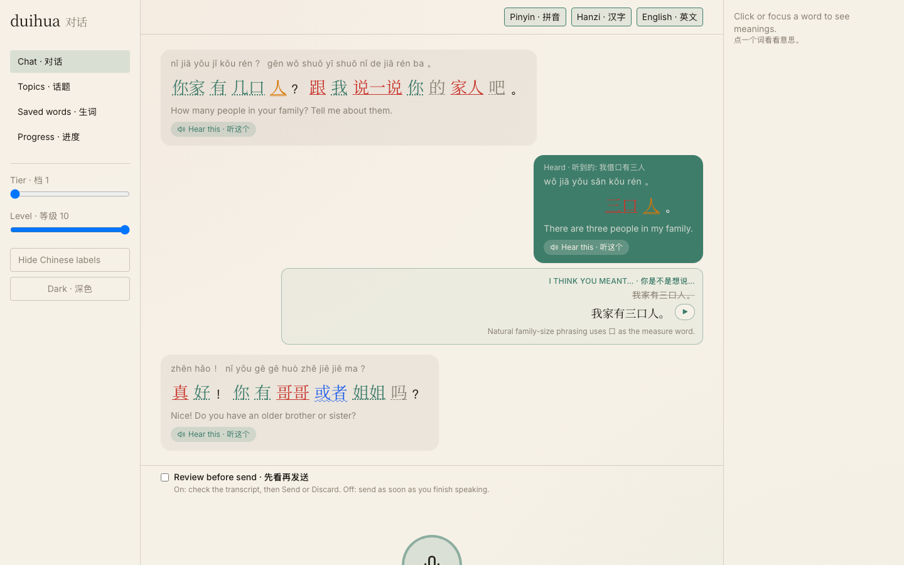

# duihua · 对话

A personal Mandarin speaking coach that runs on your machine.

I built this because I study Chinese in apps but rarely get to *speak*. duihua is the conversation partner: talk by voice, see what you said with pinyin and English, tap any word for meanings, and practise free chat or topic role-play — without an account or a subscription.



## What it does

- **Voice-first chat** — tap the mic, speak Mandarin (English words are OK), tap again when done
- **Rich transcripts** — every bubble shows pinyin, hanzi, and English; toggle any layer off
- **Word lookup** — click a word for definitions, HSK level, character breakdown; save it in one click
- **Topic role-play** — pick a scenario (restaurant, family, travel…); the AI opens in character
- **Review before send** — check the transcript (and topic-aware repairs for common STT misses) before it goes to the AI
- **Corrections** — after a turn, a short “I think you meant…” with a more natural phrasing
- **Level control** — tiers 1–10 / levels 1–100 so replies stay in range
- **Saved words & progress** — a simple word list plus XP / streak placeholders

| Conversation | Topics | Review before send |
| --- | --- | --- |
|  |  |  |

More demos (MP4 + GIF + stills): [`docs/portfolio/`](docs/portfolio/).

## Who it’s for

One learner, on their own laptop. No signup, no multiplayer, no cloud account required. Defaults aim for **free-tier or local models only**.

## Stack (short)

| Layer | Tech |
| --- | --- |
| UI | React, Vite, TypeScript, Tailwind, Zustand |
| API | FastAPI, SQLite |
| Speech | Browser STT (live) → Whisper fallback; Edge TTS |
| LLM | OpenRouter / Gemini / Ollama behind a fallback chain |
| Dictionary | CC-CEDICT + HSK lists |

Architecture is hexagonal: domain logic doesn’t import vendor SDKs; providers are swappable adapters. Deep dive: [`docs/ARCHITECTURE.md`](docs/ARCHITECTURE.md).

## Setup

Needs **Python 3.11+**, [uv](https://docs.astral.sh/uv/), and **Node 20+**.

```bash
make setup          # uv sync, npm install, copy .env, migrate
make data           # CC-CEDICT + HSK → data/dictionary.db (needs network)
# edit .env — add OPENROUTER_API_KEY and/or GEMINI_API_KEY
make dev            # API :8000 · Vite :5173
```

Open [http://127.0.0.1:5173](http://127.0.0.1:5173).

Browsers only allow the microphone on `localhost` or HTTPS. On a remote VM, forward ports:

```bash
ssh -L 5173:127.0.0.1:5173 -L 8000:127.0.0.1:8000 user@vm
```

### LLM keys (pick what you have)

In `.env` (see `.env.example`):

```bash
LLM_PROVIDERS=openrouter,gemini
OPENROUTER_API_KEY=...
GEMINI_API_KEY=...
```

Free tiers will occasionally **429**. Options:

1. Wait ~30–60s and retry (multi free models are tried in order)
2. Put a few credits on OpenRouter and use a non-`:free` model
3. Run local Ollama: `ollama pull qwen2.5:7b` then `LLM_PROVIDERS=ollama,openrouter,gemini`

## How to use it

1. Open Chat — tap the mic, speak, tap again
2. Or enable **Review before send** to confirm / discard the transcript first
3. Click any Chinese word for the side panel; **Save** keeps it under Saved words
4. Switch to **Topics**, start a scenario, and reply in Mandarin
5. Use the Pinyin / Hanzi / English toggles and tier/level sliders in the sidebar

Text input is always available as a fallback under the mic.

## Checks

```bash
make test
make lint
make portfolio   # re-record docs/portfolio demos (needs make dev running)
```

## What’s not done yet

Per the product spec, still ahead: image practice, read-aloud tone drills, and real pronunciation/tone scoring (spoken audio is already saved for that). Progress XP is wired lightly; don’t treat it as a full gamification system.

## Honest limits

- Free-tier LLM quotas cause intermittent 429s
- Browser / Whisper STT mishears accents and near-homophones; topic repair helps but isn’t perfect
- Tone scoring, when it lands, will be approximate

## Attribution

- Dictionary: [CC-CEDICT](https://www.mdbg.net/chinese/dictionary?page=cc-cedict) (CC BY-SA 4.0)
- HSK list: [drkameleon/complete-hsk-vocabulary](https://github.com/drkameleon/complete-hsk-vocabulary) (MIT)
